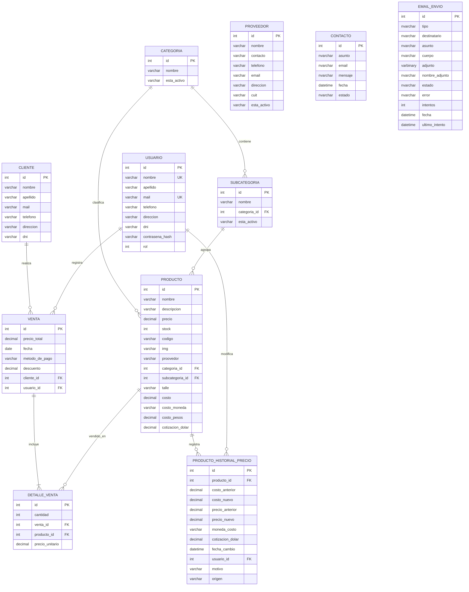

# DER — Base de datos Anirok

Este diagrama representa el esquema SQL Server utilizado por Desktop y Web después de aplicar el script inicial y las migraciones Docker.

## Observaciones de implementación

- `VENTA` es la cabecera de la operación y `DETALLE_VENTA` conserva el precio histórico de cada producto vendido.
- `PRODUCTO_HISTORIAL_PRECIO` registra cambios de costo/precio y el usuario que los realizó.
- `PROVEEDOR` existe como ABM, pero la columna histórica `producto.proovedor` todavía guarda el nombre como texto y no una clave foránea. Es una deuda de normalización pendiente.
- `CONTACTO` almacena las consultas enviadas desde la Web.
- `EMAIL_ENVIO` funciona como bandeja de salida y permite reintentar envíos fallidos.
- `rol` identifica los permisos: `1` administrador, `2` vendedor y `3` cliente web.
- Los importes monetarios se almacenan como `DECIMAL(18,2)` luego de la migración `007_monetarios_decimal.sql`.

## Relaciones principales

1. Una categoría puede tener muchas subcategorías y productos.
2. Una venta pertenece a un cliente y a un usuario/vendedor.
3. Una venta tiene uno o más detalles; cada detalle apunta a un producto.
4. Un producto puede tener muchos cambios históricos de precio.
5. Un usuario puede registrar muchos cambios de precios.

